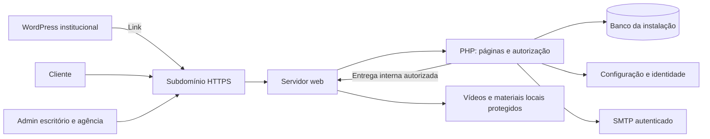

# Arquitetura v1.0 — Portal de Onboarding Contábil White Label

**Data:** 03/11/2026. **Estado:** consolidada para revisão; aprovação do responsável pelo produto pendente. As regras marcadas como padrão proposto podem ser ajustadas na revisão. Este documento substitui a proposta preliminar v0.1.

## 1. Objetivo e limites

Entregar uma plataforma exclusiva para clientes de escritórios contábeis. O site institucional WordPress direciona para o subdomínio da plataforma, que possui autenticação, banco e painel próprios. Cada escritório opera sua instalação e personaliza a experiência sem editar PHP ou CSS.

O produto é um EAD de onboarding: cursos/trilhas, módulos, aulas, materiais e acompanhamento. Cada empresa cliente possui um usuário. O administrador cria esse acesso por convite; não há cadastro público. A agência utiliza contas administrativas nominativas próprias em cada instalação.

Produção deve funcionar em hospedagem compartilhada **homologada**, sem instalar dependências por terminal. O ambiente inicial informado utiliza aaPanel no IP `89.116.52.173`; isso não altera o destino de produção nem comprova compatibilidade com todos os planos cPanel.

## 2. Decisões estruturais

| Decisão | Definição e consequência |
| --- | --- |
| D01 — Unidade de distribuição | Uma aplicação, banco, configuração e armazenamento por escritório. Sem SaaS central e sem compartilhamento de tabelas entre escritórios |
| D02 — Organização | Monólito modular: um único projeto PHP, dividido por responsabilidades. Implantação em um pacote |
| D03 — Interface | HTML renderizado no servidor, CSS responsivo e JavaScript para interações. Sem serviço Node.js em produção |
| D04 — Dependências | Instaladas e verificadas no desenvolvimento; incluídas no ZIP. Composer não precisa existir no servidor |
| D05 — Conteúdo | Curso → Módulo → Aula. “Trilha” e “jornada” são rótulos configuráveis do curso nesta versão; coleções de vários cursos ficam para uma evolução |
| D06 — Identidade | Configurações tipadas, textos centralizados e blocos predefinidos. Sem construtor livre ou execução de código editável pelo admin |
| D07 — Mídia | Vídeos locais, upload retomável/importação e entrega privada pelo servidor web. Homologação do adaptador de entrega obrigatória |
| D08 — Progresso | Conclusão manual; posição de vídeo auxilia retomada e não comprova presença ou aprendizado |
| D09 — Atualizações | Pacotes versionados com migrações, backup prévio e procedimento de restauração. Personalizações ficam fora do código distribuído |
| D10 — Aprovações | Arquitetura → preparação do ambiente → visual aprovado → funcionalidades e integrações |

## 3. Visão de implantação



PHP autoriza o acesso à mídia e retorna uma instrução interna; o servidor web transfere os bytes. O processo PHP não permanece transmitindo o vídeo. As alternativas e condições dessa entrega estão em [mídia e capacidade](04-MIDIA-E-CAPACIDADE.md).

## 4. Stack definida para a implementação

| Componente | Escolha |
| --- | --- |
| PHP | 8.3 ou superior, 64 bits; PHP 8.4 como alvo inicial recomendado |
| Rotas e middleware | Slim 4 e implementação PSR-7 compatível, distribuídos no pacote |
| Templates | Twig 3 com escape automático; administradores editam conteúdo e opções, não templates Twig |
| Persistência | PDO MySQL, repositórios pequenos, consultas parametrizadas e transações explícitas |
| Banco | Compatibilidade com MySQL 8.0+ ou MariaDB 10.11+, InnoDB e `utf8mb4`; preferir MySQL 8.4 ou MariaDB LTS mantida. Exigir atualizações de segurança do provedor e homologar as versões usadas |
| E-mails | PHPMailer via SMTP autenticado, com TLS e validação de certificado |
| Frontend | HTML semântico, CSS com variáveis de design e módulos JavaScript; escolha estética após receber a referência |
| Conteúdo rico | Sanitizador PHP mantido e compatível, selecionado e fixado no início da implementação; permitir apenas elementos e atributos previstos |
| Cache | Arquivos privados para templates/configuração; invalidação por versão de publicação. Sem Redis |
| Agendamento | Rotina curta acionada pelo Cron do painel; sem worker permanente |
| Desenvolvimento | Composer e, se necessário, ferramentas locais de assets. Lockfiles, versões exatas e auditoria antes de gerar releases |

A versão exata de cada biblioteca será fixada na primeira entrega executável, após verificação de suporte e segurança. O projeto ainda não contém `composer.json`, lockfile ou dependências instaladas.

Extensões mínimas previstas: `pdo_mysql`, `mbstring`, `fileinfo`, `openssl`, `ctype`, `filter`, `session`, `hash` e JSON. GD é exigido para o processamento de imagens previsto; cURL é usado no diagnóstico e em integrações futuras. ZIP só será necessário se uma futura função manipular pacotes no PHP; a instalação inicial usa extração pelo painel. O diagnóstico testa também permissões e caminhos, sem presumir módulos a partir do nome do painel.

Referências de compatibilidade: [PHP](https://www.php.net/supported-versions.php), [Slim](https://www.slimframework.com/docs/v4/start/installation.html), [Twig](https://twig.symfony.com/doc/3.x/intro.html), [PHPMailer](https://github.com/PHPMailer/PHPMailer) e [Composer](https://getcomposer.org/doc/01-basic-usage.md). A exigência PHP 8.3+ é uma decisão do produto, superior ao mínimo de algumas bibliotecas.

## 5. Organização proposta do código

```text
app/
  Identity/          # contas, sessões, convites e recuperação
  Clients/           # empresas, grupos e situação do cliente
  Learning/          # cursos, módulos, aulas e publicação
  Access/            # concessões, bloqueios e sequência
  Progress/          # conclusão, retomada e histórico
  Media/             # uploads, importação e adaptadores de entrega
  Branding/          # identidade, textos, navegação e blocos
  Communication/     # SMTP, fila e avisos
  Reporting/         # indicadores, filtros e CSV
  Operations/        # instalação, migrações e diagnóstico
  Shared/            # infraestrutura comum e autorização
config/              # defaults versionados; configuração privada fora do web root
database/migrations/ # migrações ordenadas
resources/views/     # templates e componentes
resources/assets/    # fontes de CSS/JS
public/              # index.php, assets públicos e entradas controladas
storage/             # estado privado, uploads e logs, fora do web root
tests/               # regras e integrações relevantes
vendor/              # gerado no build e incluído na distribuição
```

Essa árvore é um contrato para o desenvolvimento, não uma estrutura já implementada. Cada funcionalidade separa apresentação, casos de uso, regras e acesso a dados. Controllers e templates não duplicam regras de autorização ou de cálculo de progresso.

Interfaces centrais: `CourseAccessPolicy`, `ProgressService`, `MediaStorage`, `MediaDeliveryAdapter`, `MailTransport`, `SettingsRepository` e `Clock`. O adaptador de mídia muda com o servidor; o conteúdo e as permissões permanecem iguais.

## 6. Autenticação e autorização

- Login por e-mail e senha; conta vinculada a uma empresa ou a um administrador. Um usuário de cliente por empresa, garantido no banco.
- Convites e recuperação usam tokens aleatórios de uso único, armazenados como hash, com expiração. GET do link exibe o formulário; somente POST válido consome o token, para evitar consumo por scanners de e-mail.
- Padrões propostos: convite válido por 48 horas, recuperação por 30 minutos. Reenvio revoga o convite anterior. Nenhuma senha é enviada por e-mail.
- `password_hash`, `password_verify` e rehash quando apropriado; mensagens de recuperação não revelam se um e-mail está cadastrado.
- Sessões no servidor, cookies `Secure`, `HttpOnly`, `SameSite=Lax`, sem `Domain` abrangendo o WordPress. Renovar ID no login e invalidar sessões após redefinição de senha, bloqueio ou desativação.
- Padrões propostos de sessão: 30 minutos de inatividade para admin e 120 para cliente; limite absoluto de 12 horas. Requisições de retomada de vídeo contam como atividade enquanto há reprodução ativa.
- Autorização por permissão no servidor. V1 contém `office_admin`, `agency_admin` e `client`; contas da agência são auditadas e revogáveis, sem senha universal ou acesso oculto.
- Catálogo de permissões preparado para futuros colaboradores, sem incluir editor livre de perfis no primeiro escopo.

O convite ao primeiro administrador é parte do instalador controlado. O acesso da agência é criado explicitamente por instalação, com identidade individual. Proponho incluir MFA para contas administrativas na v1 por TOTP e códigos de recuperação, sem depender de SMS; clientes usam senha na v1. Esse acréscimo está destacado no escopo para aprovação.

Detalhamento dos acessos a cursos, expiração e progresso em [dados e regras](02-DADOS-E-REGRAS.md).

## 7. White label como recurso do produto

Configurações em grupos: identidade, interface, textos, contatos, conteúdo institucional, blocos, e-mails e regras do onboarding. Todo campo tem chave estável, tipo, valor padrão, validação e permissão de edição.

Os templates consultam um catálogo de textos com padrões em português e sobrescritas por instalação. Mensagens de validação, estados vazios, erros apresentados pela aplicação, botões e e-mails entram nesse catálogo. Erros do servidor web, do navegador e do player nativo são limites técnicos e devem ser convertidos em mensagens da aplicação quando possível; não se promete editar a interface interna do navegador.

Cor, tipografia e espaçamentos previstos são aplicados por tokens CSS. Fontes são selecionadas de opções locais licenciadas, sem campo de CSS livre. Imagens por contexto evitam distorção de logo e recortes imprevisíveis. O painel também recebe a marca da instalação.

Blocos predefinidos podem ser editados, ativados, desativados e reordenados em regiões permitidas. Login, segurança, controles de acesso e ações administrativas essenciais permanecem funcionais. Ocultar uma entrada de menu não concede nem revoga uma permissão.

O pacote de replicação exporta identidade, textos e conteúdo inicial selecionado com manifesto de versão. Exclui usuários, CNPJ de clientes, progresso, logs, SMTP, chaves, tokens e caminhos absolutos. Cada instalação gera suas próprias chaves e credenciais. Exportar vídeos, pelo volume, é uma operação separada do pacote de identidade.

## 8. Proteção de dados e segurança

- Validar todas as entradas no servidor; proteção CSRF em alterações; autorização também em JSON, mídia e downloads. Formulários, configuração e conteúdo têm limites de tamanho e rate limits apropriados.
- Sanitizar HTML rico por lista permitida. Proibir scripts, manipuladores de eventos, iframes arbitrários e URLs perigosas. Escape por contexto na saída.
- Configuração, banco, SQL, logs, backups, temporários e segredos fora da área pública. Uploads nunca executam PHP ou outro código. Lista inicial de tipos permitidos por finalidade; negar executáveis, HTML e arquivos com macros. SVG só se houver sanitização específica homologada; PNG/WebP/JPEG são o padrão para imagens.
- Limitar tentativas de login, convites, recuperação e uploads. Configurar CSP e cabeçalhos de segurança após inventário do player e assets; páginas privadas não entram em cache compartilhado.
- Guardar segredos SMTP cifrados com chave privada da instalação ou em arquivo privado; nunca devolver o segredo ao formulário nem registrá-lo em logs. Rotação e restauração precisam considerar essa chave.
- Logs administrativos registram autor, ação, objeto, horário UTC e resultado. Reduzir dados pessoais, não registrar senhas/tokens e limitar acesso aos registros.
- Escritório e agência devem documentar responsabilidades pelo tratamento, finalidade, base legal, operadores, retenção e atendimento ao titular. O sistema oferece exportação e fluxo administrativo de exclusão/anonimização; esses recursos não substituem as decisões de governança do escritório.
- Manter aviso de privacidade e canal de contato editáveis. Não vincular a prestação do serviço a consentimento genérico obrigatório para todo tratamento.
- Propostas de retenção operacional: temporários de upload 24 horas, recuperação expirada removida em até 24 horas, eventos operacionais 90 dias e auditoria administrativa 180 dias; confirmar com o responsável antes da ativação. Retenção de cadastro/progresso e hipóteses de conservação exigem política específica.

Ao excluir um titular, revogar sessões/tokens, remover ou anonimizar os vínculos definidos, minimizar auditoria e tratar cópias exportadas e backups pela política de retenção. Depois de uma restauração, reaplicar o registro de exclusões para não reativar cadastros removidos.

Fontes: [OWASP — sessões](https://cheatsheetseries.owasp.org/cheatsheets/Session_Management_Cheat_Sheet.html), [OWASP — uploads](https://cheatsheetseries.owasp.org/cheatsheets/File_Upload_Cheat_Sheet.html), [ANPD — guia de segurança](https://www.gov.br/anpd/pt-br/centrais-de-conteudo/materiais-educativos-e-publicacoes/guia-vf.pdf) e [ANPD — aspectos de conformidade fiscalizados](https://www.gov.br/anpd/pt-br/assuntos/fiscalizacao/saiba-como_fiscalizamos). Os períodos e fluxos acima são decisões propostas para este produto.

## 9. Comunicação e tarefas agendadas

Convites e recuperação são obrigatórios. A solicitação grava token e mensagem em transação; uma tentativa SMTP curta pode ocorrer imediatamente, com estado visível de falha e reenvio. Retentativas e avisos passam por fila no banco e Cron, com chave de idempotência, bloqueio por tempo limitado, tentativas máximas e backoff. Proteger o payload temporário de convites, pois contém o link de uso único; apagá-lo após envio/expiração.

Cron executa lotes pequenos, encerra e impede sobreposição. Sem Cron confiável, desabilitar lembretes automáticos e exibir a limitação; convites e recuperação continuam com envio imediato e reenvio administrativo. Taxas respeitam o provedor SMTP. Registrar último processamento e falhas no diagnóstico.

WhatsApp abre `wa.me` com número validado e mensagem editável. Não existe automação de mensagens WhatsApp na v1. FAQ e comunicados simples são blocos configuráveis; formulários/questionários ficam preparados como tipo de aula futuro.

## 10. Condições de aprovação

A arquitetura fecha o desenho lógico. A capacidade da hospedagem depende das evidências de homologação. A revisão deve confirmar as regras propostas, o escopo e os critérios de mídia. Instalação do ambiente e implementação seguem as etapas de [requisitos e entregas](06-REQUISITOS-E-ENTREGAS.md), sem antecipar o desenvolvimento completo.
