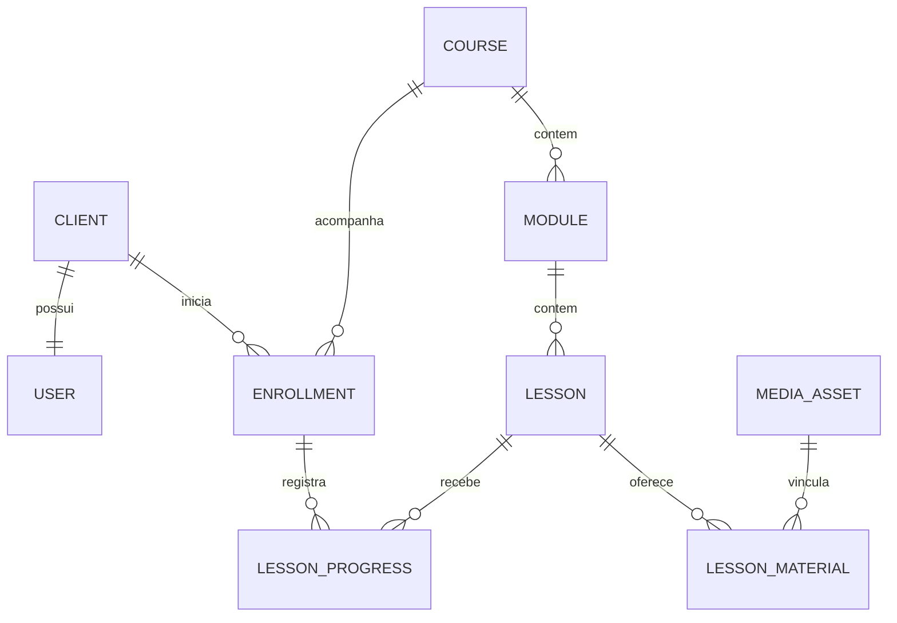

# Modelo de dados e regras de negócio

Arquitetura v1.0, para revisão. Modelo lógico; o SQL será implementado após a aprovação visual e não representa migrações já executadas.

## 1. Convenções

- Banco por escritório: não existe `tenant_id` compartilhado entre escritórios.
- IDs internos `BIGINT UNSIGNED`; identificadores expostos podem ser UUIDs opacos. Isso complementa, sem substituir, a autorização.
- Tamanho de arquivo em `BIGINT UNSIGNED`; PHP 64 bits obrigatório. Não usar inteiro de 32 bits, `FLOAT`, BLOB de vídeo no banco ou leitura integral do arquivo na memória.
- Horários em UTC em `DATETIME`, apresentados no fuso da instalação; padrão `America/Sao_Paulo`.
- `utf8mb4` com collation comum aos bancos homologados. Chaves estáveis, hashes e identificadores normalizados com comparação apropriada à sua semântica.
- Objetos de configuração em texto serializado validado na aplicação, sem depender de consultas JSON específicas de um banco.
- FKs e índices explícitos; exclusão em cascata somente nos relacionamentos sem histórico a conservar.
- Campos de publicação e arquivamento separados; operações relevantes usam transações e auditoria.

## 2. Entidades

| Tabela | Campos e restrições principais |
| --- | --- |
| `clients` | Empresa, responsável, CNPJ normalizado, telefone, WhatsApp, status `active/inactive`, datas. `UNIQUE(cnpj)` quando preenchido |
| `users` | `client_id` nullable e único, `role_id`, e-mail normalizado único, hash de senha nullable até ativação, status, `last_login_at`, `auth_version`. Admin não tem `client_id`; cliente deve ter |
| `roles` / `role_permissions` | Perfis fixos iniciais e permissões de catálogo. Sem personalização livre de perfis na v1 |
| `auth_sessions` | Hash do identificador, usuário, expiração, última atividade, versão de autenticação. Nenhum token bruto |
| `auth_tokens` | Usuário, finalidade `invite/reset`, hash único, validade, uso e revogação. Apenas uma emissão vigente por finalidade |
| `user_mfa` / `mfa_recovery_codes` | Segredo TOTP cifrado e códigos de recuperação com hash para administradores, caso aprovado o requisito proposto de MFA |
| `client_groups` / `client_group_members` | Grupos, membros, unicidade do vínculo e auditoria de mudanças |
| `courses` | Título, slug único, descrição, capa, ordem, estado, sequência obrigatória, revisão e regra de acesso padrão |
| `modules` | Curso, título, descrição, ordem e estado. Ordenação estável por posição e ID |
| `lessons` | Módulo, título, corpo sanitizado, vídeo opcional, capa opcional, ordem e estado |
| `client_course_access` | `UNIQUE(client_id, course_id)`, modo `allow/deny`, início e expiração. Exceção individual explícita |
| `group_course_access` | `UNIQUE(group_id, course_id)`, início e expiração da concessão |
| `enrollments` | `UNIQUE(client_id, course_id)`, primeiro acesso, último acesso, última aula, primeira conclusão e revisão correspondente |
| `lesson_progress` | `UNIQUE(enrollment_id, lesson_id)`, concluída em, posição em segundos e última reprodução |
| `progress_events` | Eventos de conclusão, desfazer, reset e retomada relevante; ator e contexto mínimos. Não gravar evento a cada segundo |
| `media_assets` | UUID, chave de armazenamento relativa, nome original, tipo, MIME, tamanho, hash, estado, autor, datas e referências de uso |
| `lesson_materials` | Aula, arquivo ou URL externa permitida, título e ordem. Exatamente um destino |
| `upload_sessions` | UUID, usuário, tamanho esperado, deslocamento recebido, quota reservada, prazo, estado e chave temporária |
| `settings` / `settings_revisions` | Chave única tipada, valor, revisão e autor; histórico limitado de publicação |
| `ui_blocks` / `navigation_items` | Chave estável, região, tipo, conteúdo validado, estado, ordem e público previsto |
| `announcements` / `faq_items` | Conteúdo simples, publicação, ordem e visibilidade. Sem motor de campanhas |
| `mail_outbox` | Destinatário, template, payload temporário protegido, deduplicação, tentativas, próximo envio, bloqueio e resultado |
| `audit_events` | Ator, ação, entidade, resultado, horário e diferenças minimizadas, sem segredos |
| `data_requests` | Solicitações administrativas de exportação/exclusão, escopo, resultado e prazo de retenção do registro |
| `schema_migrations` / `installation_state` | Versões, checksum, status da instalação, release e locks operacionais |

Relação principal:

A relação um para um cliente/usuário vale para contas de clientes; administradores existem separadamente na tabela `users`. Vínculo de cliente e estado são verificados também na aplicação, pois restrições entre múltiplas tabelas não são todas expressas por uma única FK. Se várias pessoas da empresa utilizarem esse único acesso, o progresso será compartilhado pela empresa; não haverá identificação individual de colaboradores nesta versão.

### Cadastro e CNPJ

Padrão proposto: responsável, e-mail, empresa e CNPJ obrigatórios; telefone ou WhatsApp deve estar preenchido. Ambos aparecem no cadastro e podem ser editados pelo admin. E-mail pertence à identidade de login e não é duplicado no perfil da empresa.

Tratar CNPJ como texto normalizado de 14 caracteres, incluindo letras nas primeiras 12 posições e dois verificadores numéricos, com máscara compatível e validação oficial. Não remover todas as letras nem converter para número. Os formatos numérico e alfanumérico coexistem. Fonte: [Receita Federal — CNPJ alfanumérico](https://www.gov.br/receitafederal/pt-br/acesso-a-informacao/acoes-e-programas/programas-e-atividades/cnpj-alfanumerico/cnpj-alfa).

## 3. Autorização de cursos

Resolver a política em toda página, pedido de mídia, download e alteração de progresso. Ocultar botões não substitui a verificação.

Ordem determinística proposta:

1. Usuário e empresa precisam estar ativos; sessão precisa ser válida.
2. Curso, módulo e aula precisam estar publicados e não arquivados. Admin usa uma rota de prévia própria, auditada.
3. Uma exceção individual `deny` bloqueia o curso, mesmo que um grupo o conceda.
4. Se existe exceção individual `allow`, sua janela de acesso governa o curso. Expirada ou ainda não iniciada, ela bloqueia o acesso e não recai sobre concessões de grupo ou padrão.
5. Sem exceção individual, qualquer concessão de grupo vigente libera o curso. Havendo várias, basta uma vigente; mostrar a validade efetiva mais longa, ou sem prazo quando alguma vigente não expira.
6. Sem concessão de grupo vigente, a regra padrão do curso pode liberar o acesso a todos os clientes. Para remover um cliente de curso aberto a todos, criar o bloqueio individual explícito.
7. Ausência de concessão válida resulta em acesso negado.

Janelas usam início inclusivo e expiração exclusiva: `starts_at <= agora` e `agora < expires_at`, quando definidos. “Até o fim do dia” é convertido no backend para o início do dia seguinte no fuso da instalação, evitando ambiguidade de segundos.

Expiração mantém histórico e progresso, bloqueando consumo e novas conclusões; o cliente vê o estado do curso e contato de suporte. Prorrogação permite continuar com o progresso existente. Saída de grupo revoga apenas a concessão desse grupo. A interface administrativa deve exibir a origem do acesso e simular o resultado de uma alteração antes de salvá-la.

“Remover a exceção individual” e “bloquear acesso” são ações distintas. A primeira pode restaurar acesso por grupo; a segunda cria `deny`. Essa diferença deve ser explícita na interface.

## 4. Publicação, ordenação e exclusão

- Estados de conteúdo: `draft`, `published`, `archived`.
- Publicar curso exige pelo menos uma aula publicada em módulo publicado. Aula precisa ter conteúdo válido; vídeo vinculado precisa estar pronto para reprodução.
- Campos comerciais/institucionais têm prévia e publicação. Editar um rascunho não altera a experiência atual até publicar.
- Na v1, edição de conteúdo já publicado exige salvar/publicar conscientemente, com auditoria; não se constrói um editor completo de revisões de todas as aulas.
- Exclusão definitiva de rascunho sem uso é permitida. Conteúdo com consumo/progresso é arquivado para preservar referências. Exclusão física de mídia exige verificar vínculos e confirmar que não está em uso.
- Reordenar não altera IDs nem apaga progresso. Aula com histórico não muda para outro curso: duplicar conteúdo no curso de destino e arquivar o original quando necessário.
- Uma transação valida a lista completa de IDs e a autorização ao salvar uma ordenação. Não confiar em IDs enviados pelo navegador.

## 5. Progresso e sequência

Progresso do módulo = aulas publicadas concluídas / aulas publicadas elegíveis do módulo. Progresso do curso usa a contagem de aulas, sem fazer média simples dos percentuais dos módulos. Denominador zero resulta em 0% e estado “sem aulas disponíveis”, nunca em conclusão automática.

O percentual global de um cliente é a razão entre todas as suas aulas concluídas e todas as aulas atualmente elegíveis nos cursos vigentes. Na v1 cada aula pertence a um único curso; não há reaproveitamento da mesma linha em cursos distintos.

Conclusão:

- Botão “Concluir aula” chama operação idempotente. Repetir a requisição não duplica progresso ou eventos.
- Padrão proposto: cliente pode desfazer sua conclusão; mantém histórico. Admin pode resetar um curso ou aula com confirmação e motivo auditado.
- Curso é concluído quando todas as aulas publicadas correntes foram concluídas. Guardar a primeira conclusão e a revisão do conteúdo, sem usar somente o percentual como histórico.
- Adicionar uma nova aula publicada pode reduzir o percentual atual; conclusão histórica permanece registrada com a revisão anterior. A interface informa que há conteúdo novo. Arquivar aulas as retira do cálculo atual sem apagar seus registros históricos.
- Posição do vídeo é independente do botão de conclusão. Salvar aproximadamente a cada 30 segundos durante reprodução, em pausa e troca de aula; tentativas no fechamento da aba são apenas melhor esforço.
- Validar posição finita e não negativa, limitar à duração confiável quando disponível e fazer debounce no cliente. Cada sessão de reprodução identifica e ordena suas gravações; descartar pedidos atrasados, permitindo retrocesso intencional do player. Conflitos entre abas usam a última gravação válida recebida pelo servidor, sem confiar no relógio do navegador.
- “Continuar” abre a última aula ainda acessível. Se ela foi arquivada ou bloqueada, procurar a próxima pendente; se o curso terminou, mostrar revisão/curso concluído.

Sequência é livre por padrão. Quando ativada no curso, todas as aulas publicadas anteriores na ordem módulo/aula precisam estar concluídas para abrir a próxima. A mesma regra vale para mídia e materiais. Desfazer uma conclusão anterior pode bloquear aulas seguintes; conclusões históricas dessas aulas permanecem. O admin vê esse efeito antes de ativar a sequência em curso já utilizado.

## 6. Indicadores com definição explícita

| Indicador | Regra proposta |
| --- | --- |
| Total de clientes | Empresas não excluídas, independentemente de já terem aceitado convite |
| Ativos / inativos | Estado administrativo da empresa; não equivale a login recente |
| Convite pendente | Identidade ainda não ativada; informar separadamente de inatividade |
| Nunca iniciou | Cliente elegível com zero aulas acessadas no curso |
| Em andamento | Ao menos uma aula acessada e percentual atual inferior a 100% |
| Concluiu | Percentual atual 100%, com referência à revisão do conteúdo |
| Último acesso | Último login e última atividade apresentados como informações distintas |
| Sem atividade | Cliente com curso vigente, não concluído, sem atividade há N dias; padrão proposto N = 14 |
| Possível abandono | Segmento operacional de “sem atividade”, após ter iniciado; não é declaração de intenção do cliente |
| Média de conclusão | Média dos percentuais por par cliente/curso com acesso vigente, incluindo os que ainda não iniciaram; mostrar quantidade incluída |
| Conteúdo expirado | Segmento separado, fora da média de cursos vigentes |

Visão individual mostra acesso efetivo, origem, validade, linha do tempo, módulos e aulas concluídos, retomada e alterações administrativas relevantes. A elegibilidade dos relatórios não depende de o cliente já ter uma matrícula registrada; “nunca iniciou” precisa aparecer.

CSV faz parte da v1 proposta, com UTF-8 e opção compatível com Excel, colunas documentadas, filtros iguais aos da tela, autorização e proteção contra fórmulas iniciadas por `=`, `+`, `-`, `@`, tabulações e caracteres de controle. XLSX nativo é evolução; não chamar CSV de arquivo XLSX.

## 7. Índices e consistência

- Índices nos vínculos usuário/cliente, e-mail normalizado, CNPJ, curso/módulo/ordem, módulo/aula/ordem, concessões por cliente/grupo/curso e expiração.
- `enrollments(client_id, course_id)` único e índices para última atividade; `lesson_progress(enrollment_id, lesson_id)` único.
- Fila de e-mail indexada por estado/próxima tentativa; upload por autor/estado/expiração; auditoria por data e objeto.
- Evitar N+1 ao listar cursos e relatórios. Paginar clientes, mídia e eventos; limitar tamanho de exportação/lotes.
- Sessões e conexões de banco não persistem durante a transferência de mídia. Retomada do vídeo produz gravações curtas e espaçadas, sem polling de relatórios a cada segundo.
- Locks com prazo e token de posse em upload, fila, instalação e migrações. Liberação só pelo proprietário; uma rotina interrompida não deixa bloqueio eterno.
- Separar backup de recuperação e migração de schema. DDL pode fazer commit implícito: não prometer rollback transacional de toda migração.

## 8. Casos obrigatórios de validação posterior

Um único usuário por empresa; troca de e-mail sem perda de progresso; reenvio de convite revoga o anterior; expiração em limite de horário; bloqueio individual prevalece sobre grupos; concessões múltiplas; cliente A não altera cliente B; acesso à mídia respeita sequência; repetição de conclusão não duplica eventos; publicação/arquivamento recalcula percentuais; CNPJ numérico e alfanumérico; CSV não executa fórmulas; exclusão/anonimização não reativa conta após restauração.
