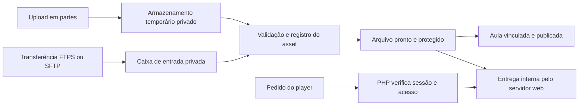

# Vídeos grandes, entrega privada e capacidade

## 1. Requisitos e classificação da demanda

- Aproximadamente 10 vídeos inicialmente, com suporte a arquivos individuais maiores que 2 GB.
- Armazenamento na própria hospedagem; player HTML5. Sem dependência de YouTube, Vimeo, conversão no servidor ou serviço externo de vídeo.
- Pico habitual informado posteriormente pelo responsável: abaixo de 10 espectadores simultâneos.
- Cenário de expansão a documentar e validar antes de utilizá-lo: mais de 50; proposta de ensaio com 60 espectadores.
- A certificação de capacidade pertence à instalação/plano/bitrate testados. Não é uma característica garantida apenas pelo código.

O objetivo inicial de validação funcional é atender 10 espectadores. O resultado para 60 deve ser registrado separadamente como aprovado, reprovado ou não executado; não anunciar suporte a mais de 50 antes dessa evidência. Essa divisão interpreta a atualização do responsável e está sujeita à revisão da arquitetura.

## 2. Restrição encontrada na HostGator

Na consulta de 03/11/2026, a seção 4.1 dos [termos da HostGator](https://www.hostgator.com.br/termos-de-servico) inclui armazenamento e streaming de áudio/vídeo entre as restrições de servidores compartilhados. Assim, os planos compartilhados usuais dessa referência **não estão homologados para o requisito de vídeos locais**. Antes de usar um plano desse provedor, obter uma definição formal aplicável ao produto contratado; alternativamente, homologar outro provedor compartilhado com cPanel que permita esse uso.

A página de [limitações da HostGator](https://suporte.hostgator.com.br/hc/pt-br/articles/30816318898963-Quais-s%C3%A3o-as-limita%C3%A7%C3%B5es-dos-servidores-da-HostGator) informa limites de CPU, processos e capacidade física mesmo para tráfego comercialmente ilimitado. Esses números variam por produto e não devem ser convertidos diretamente em número de espectadores. Vídeo estático e processo PHP são recursos distintos.

A escolha de hospedagem permanece pendente. A implementação deve manter o armazenamento local exigido e expor requisitos verificáveis, sem introduzir outra plataforma de vídeo silenciosamente.

## 3. Pipeline de mídia

Formato editorial de referência: MP4 H.264/AAC preparado para início rápido, com duração, resolução, bitrate e capa informados no cadastro ou manifesto. Arquivos MOV/MKV não são aceitos como equivalentes reproduzíveis apenas por trocar a extensão. Legendas WebVTT são anexos opcionais.

Não haverá transcodificação, HLS, geração de múltiplas resoluções nem extração de thumbnails na hospedagem na v1. Preparar e comprimir os vídeos antes do envio. Sem ferramenta de inspeção disponível, validação de extensão/MIME não prova codec: o fluxo exige prévia real no navegador antes de publicação.

## 4. Upload retomável em partes

Usar protocolo simples de partes sequenciais com deslocamento confirmado e sessão autenticada. Tamanho inicial proposto de parte: 8 MiB, configurável para baixo conforme o menor limite entre servidor, proxy/WAF e PHP. Não aumentar o limite geral do servidor para vários GB só para receber um único POST.

1. Admin abre uma sessão com nome, tipo e tamanho total. Servidor valida permissão, quota, espaço, limite individual e reserva o volume necessário.
2. Servidor devolve UUID de upload, validade, tamanho máximo de parte e deslocamento confirmado.
3. Navegador envia uma parte binária por vez, com deslocamento, comprimento e checksum SHA-256 daquela parte. Corpo é lido por stream em buffer limitado, sem carregar o arquivo completo.
4. Lock exclusivo por upload impede gravações concorrentes. Confirmar integridade antes de avançar o deslocamento. Parte duplicada previamente confirmada é reconhecida pelo registro do intervalo/checksum; não anexar duas vezes.
5. Ao reconectar, consultar o deslocamento do servidor. Retomada após fechar o navegador pode exigir selecionar novamente o arquivo e validar sua identidade; não prometer acesso permanente do navegador ao arquivo local.
6. Finalização verifica total, integridade das partes, tipo permitido, destino e espaço. Transição idempotente para asset pronto; mover/renomear no mesmo filesystem, evitando uma longa montagem final.

Preferir um arquivo temporário contíguo por sessão e um diário de partes confirmadas em metadados, evitando milhares de arquivos/inodes e a necessidade de montar novamente vários GB. Uma parte interrompida não vira progresso confirmado. Recuperação compara diário, deslocamento e tamanho real sob lock, reparando apenas o temporário dessa sessão; filesystem e SQL não são uma transação única.

Checksum por parte e tamanho são obrigatórios. Hash SHA-256 completo do arquivo é opcional para manifestos de importação ou verificação assistida; não fazer uma varredura de vários GB em uma única requisição web curta como condição oculta para finalizar todo upload.

Uploads têm dono, expiração e limite de sessões concorrentes. Padrões propostos: uma parte por sessão, até duas sessões por admin, sessão válida por 24 horas desde a última atividade. O cancelamento e a limpeza atingem somente caminhos da área temporária associados à sessão validada. O admin visualiza e pode limpar sessões abandonadas; Cron automatiza a limpeza quando disponível.

O sistema deve distinguir espaço consumido, reservado e livre. Se o host não expuser a quota real da conta via API, configurar uma quota de aplicação e informar a limitação; `disk_free_space` isolado pode mostrar o filesystem do servidor, não o saldo do plano.

PHP 64 bits é obrigatório para tamanho e offsets acima de 2 GB. Referência: [manual de filesize do PHP](https://www.php.net/manual/en/function.filesize.php). O tamanho máximo do produto será configurável e homologado com o host; cenário inicial de teste inclui um arquivo de pelo menos 3 GiB, sem prometer tamanho ilimitado.

## 5. Alternativa de transferência e importação

Quando o upload pelo navegador for inviável, o operador envia o arquivo por **FTPS ou SFTP**, conforme os recursos do host, para uma caixa de entrada privada com acesso restrito. FTP sem cifragem não é o transporte padrão. SFTP depende de o host oferecer esse acesso; não presumir que todo plano o possui.

O admin seleciona arquivos dessa caixa por uma lista gerada pelo servidor, informa metadados e importa. Não aceitar caminho arbitrário, URL remota ou link simbólico fornecido pelo formulário. Validar `realpath`, raiz permitida, ausência de arquivo ainda em transferência, tamanho e tipo. Usar convenção de arquivo `.part` e renomeação final pelo operador, ou manifesto final, para identificar envio concluído.

Manter caixa de entrada e destino no mesmo filesystem para renomeação. Se for inevitável copiar entre volumes, usar operação assistida/retomável e reservar espaço adicional; não copiar um arquivo grande durante uma requisição sem limite conhecido.

## 6. Entrega privada sem streaming pelo PHP

O player acessa uma rota da aplicação. PHP valida usuário, curso, prazo, sequência, aula e asset; fecha sua sessão de escrita e conexão de dados; retorna instrução de entrega interna com MIME e cabeçalhos adequados. O servidor web responde ao navegador com os bytes.

| Adaptador | Recurso necessário | Condição |
| --- | --- | --- |
| Nginx / aaPanel | `X-Accel-Redirect` e location `internal` com alias controlado | Configuração do virtual host disponível e testada. aaPanel não implica Nginx automaticamente |
| Apache / cPanel | Módulo `mod_xsendfile` habilitado e diretórios privados autorizados | Provedor precisa disponibilizar o módulo e a configuração; não é uma instalação feita pelo produto |
| LiteSpeed | `X-LiteSpeed-Location` e proteção da URI interna | Testar regras específicas de acesso direto e redirecionamento interno |

Documentação dos mecanismos: [Nginx — internal](https://nginx.org/en/docs/http/ngx_http_core_module.html#internal), [Nginx — processamento do X-Accel-Redirect](https://nginx.org/en/docs/http/ngx_http_fastcgi_module.html#fastcgi_ignore_headers), [mod_xsendfile](https://tn123.org/mod_xsendfile/) e [LiteSpeed — internal redirect](https://docs.litespeedtech.com/lsws/redirect/).

Em Nginx/Apache, preferir arquivos fora do web root. LiteSpeed usa URI interna e pode exigir uma área sob contexto/document root com bloqueio comprovado de pedidos externos; testar isso explicitamente. Um header configurado sem mecanismo ativo não entrega proteção nem capacidade.

Se nenhum adaptador for comprovado, a instalação não está apta a publicar vídeos privados neste perfil. O diagnóstico deve apontar o recurso ausente. Não substituir por URL pública, caminho aleatório ou laço PHP transmitindo todo o vídeo. A arquitetura não depende de modificação de servidor feita por nós no plano compartilhado; depende de escolher um plano com o recurso pronto ou disponibilizado pelo provedor.

## 7. Semântica HTTP, privacidade e cache

- Validar `GET`, `HEAD`, `Range`, `If-Range`, respostas 200/206/416, avanço, retomada e Content-Length com arquivos grandes. Referência: [MDN — pedidos Range](https://developer.mozilla.org/en-US/docs/Web/HTTP/Guides/Range_requests).
- Caminhos internos são montados a partir de chaves armazenadas e validadas; nunca concatenar caminhos recebidos do cliente. Bloquear travessia, symlinks e destinos fora da raiz.
- Pedidos anônimos, expirados ou sem concessão não recebem bytes privados. Acesso direto à área interna precisa falhar também com codificação de URL, barras duplicadas e variações de caminho.
- Exigir autorização em cada novo pedido, inclusive Range. Revogação impede novas requisições; uma resposta de vídeo já em transferência pode continuar até terminar. Não prometer interrupção instantânea de todos os bytes em trânsito.
- Páginas, mídia privada e respostas de autorização ficam fora de cache compartilhado de proxy/CDN. Política inicial conservadora `private, no-store`, a validar com o adaptador e a retomada do player.
- Não introduzir Cloudflare proxy/cache como solução de banda para vídeos. O DNS pode ser administrado no Cloudflare sem passar o tráfego pelo proxy.
- Materiais públicos de identidade são separados de materiais privados das aulas. Planilhas e documentos usam download como anexo quando apropriado; não executar conteúdo enviado.

O controle de acesso restringe a entrega; usuários autorizados ainda podem copiar ou gravar conteúdo reproduzido. Não se inclui DRM ou garantia de impedir cópias.

## 8. Dimensionamento por bitrate

Fórmulas de planejamento, em unidades decimais:

- Banda agregada aproximada em Mbps = espectadores simultâneos × bitrate do vídeo em Mbps.
- Transferência em GB = espectadores × bitrate em Mbps × segundos assistidos ÷ 8 ÷ 1.000.
- Bitrate médio em Mbps ≈ tamanho em GB × 8.000 ÷ duração em segundos.

| Bitrate médio | 10 espectadores | 60 espectadores | Transferência de 60 espectadores por 1 hora |
| --- | --- | --- | --- |
| 2 Mbps | 20 Mbps | 120 Mbps | 54 GB |
| 4 Mbps | 40 Mbps | 240 Mbps | 108 GB |
| 8 Mbps | 80 Mbps | 480 Mbps | 216 GB |

Valores calculados para mídia, sem overhead, picos de buffer, seeks e concorrência do site. Margem inicial de planejamento proposta de 30% não substitui medição. Exemplo: 2 GB em 30 minutos correspondem a cerca de 8,9 Mbps; o tamanho isolado não informa se o vídeo está bem dimensionado.

Dez vídeos de 3 GiB consomem 30 GiB só em mídia. Uploads temporários, versões substituídas, imagens, documentos e backups precisam de espaço adicional. Não embutir vídeos em todo ZIP de atualização nem contar com backup automático do host para esse volume.

## 9. Evidência exigida por plano

Registrar permissão de uso, espaço/quota, arquivo máximo, banda sustentada, política de tráfego, conexões HTTP, I/O, CPU, memória, processos PHP, conexões MySQL, proxy/WAF, limites de upload e recurso de entrega interna. Incluir o impacto de compartilhar recursos com WordPress na mesma conta, quando aplicável.

Testes: upload e importação acima de 2 GiB; interrupção e retomada; acesso privado; seek no início/meio/fim; 10 espectadores; expansão gradual para 60 quando autorizada pelo provedor; uso simultâneo do admin e do site institucional. Procedimento e metas em [operação e homologação](05-OPERACAO-E-HOMOLOGACAO.md).

Não executar carga pesada em infraestrutura compartilhada sem alinhar o procedimento com o provedor. Nesta etapa houve apenas pesquisa e consultas leves de DNS/HTTP; nenhum teste de carga ou upload foi executado.
